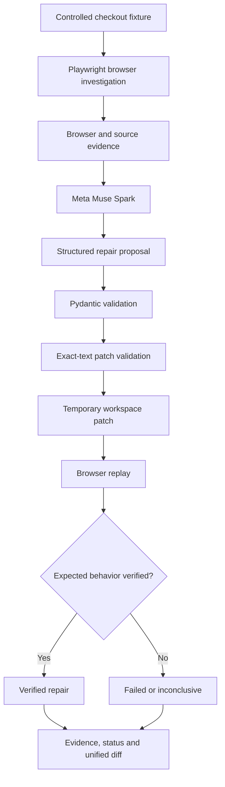

# SI ORBIT

**AI proposes. The browser decides.**

SI ORBIT is an evidence-driven browser debugging and repair prototype. It investigates a controlled web UI failure, gathers browser and source-code evidence, asks Meta's Muse Spark model to propose a repair, validates that proposal, applies a narrowly scoped patch to a temporary copy, and independently replays the browser interaction to determine whether the repair worked.

Rather than treating an AI-generated explanation as proof, SI ORBIT separates **investigation, proposal, patching, and verification**.

> **Core principle:** A proposed fix is not a verified fix. The browser must provide evidence that the expected behavior actually works.

---

## 1. The problem

Debugging web applications often involves several disconnected steps:

- Reproducing a failure.
- Understanding browser errors.
- Finding the relevant source-code issue.
- Developing a possible correction.
- Applying the correction.
- Testing whether the original failure is resolved.

AI coding assistants can suggest fixes, but a plausible explanation or code change does not establish that the application works afterward.

SI ORBIT explores a more evidence-driven workflow in which model-generated proposals are constrained and tested against actual browser behavior.

## 2. What SI ORBIT does

The current prototype supports a controlled checkout-page debugging scenario.

Its capabilities include:

- **Browser investigation:** Uses Playwright to load the sample checkout page, interact with its button, and collect relevant browser evidence.
- **Source inspection:** Checks selected source-code conditions, including mismatched HTML element IDs.
- **AI-generated repair proposals:** Uses Meta Muse Spark to produce structured repair proposals based on the collected evidence.
- **Strict proposal validation:** Uses Pydantic schemas to reject unexpected fields, unsupported decisions, and invalid patch operations.
- **Constrained patching:** Applies an exact-text replacement to an isolated temporary copy of the fixture.
- **Independent browser verification:** Replays the interaction and checks whether the expected result appears without browser errors.
- **Transparent reporting:** Returns the model's proposal, repair attempts, verification evidence, and a unified diff.
- **Custom evidence analysis:** Accepts user-provided descriptions, logs, and source text for limited static analysis.

The custom evidence mode analyzes supplied text. It does not execute arbitrary submitted code.

## 3. How it works

The repair workflow follows these stages:

1. **Reproduce:** Load the controlled checkout fixture in a browser and reproduce the interaction failure.
2. **Collect evidence:** Capture browser behavior, errors, source analysis, and relevant source text.
3. **Generate a proposal:** Send the evidence to Muse Spark and request a structured repair proposal.
4. **Validate:** Check the response against strict Pydantic models and verify that the proposed replacement matches the supplied source.
5. **Apply:** Apply an allowed exact-text replacement to a temporary copy rather than modifying the original fixture.
6. **Replay:** Run the browser interaction again against the patched copy.
7. **Verify:** Check page loading, interaction success, browser errors, and the expected confirmation message.
8. **Report:** Return the outcome, evidence, attempts, and patch diff.

### Workflow overview



## 4. Example: checkout element-ID mismatch

The demonstration fixture contains a specific JavaScript/HTML mismatch.

The JavaScript attempts to access an element with the ID `checkout-message`, while the HTML defines the element using the ID `message`.

This causes the browser interaction to fail because the requested element cannot be found.

SI ORBIT's demonstration workflow:

- Reproduces the browser failure.
- Identifies the mismatch in the supplied source.
- Requests a repair proposal from Muse Spark.
- Validates the proposed selector correction.
- Changes the selector in a temporary copy.
- Replays the checkout interaction.

The successful demonstration produced the following result:

| Check | Demonstration result |
|---|---|
| Initial browser failure | Reproduced |
| Source mismatch | Detected |
| Muse Spark proposal | Generated |
| Patch validation | Passed |
| Temporary patch | Applied |
| Browser replay | Passed |
| Browser errors after repair | 0 |
| Expected confirmation | Displayed |
| Original fixture | Unchanged |

The verified result is specific to this controlled fixture. It does not establish that SI ORBIT can automatically repair arbitrary websites.

## 5. Architecture and engineering

SI ORBIT uses a modular Python backend, a browser automation layer, a lightweight frontend, and a model integration.

### Main components

| Component | Responsibility |
|---|---|
| FastAPI application | API endpoints and workflow orchestration |
| Browser inspector | Playwright-based browser investigation |
| Root-cause verifier | Selected source-code checks |
| Meta model client | Muse Spark API communication |
| Agent schemas | Strict structured proposal validation |
| Patch engine | Constrained exact-text patch application |
| Repair loop | Investigation, proposal, patching, and replay orchestration |
| Frontend | Investigation interface and result presentation |

### Repair agent modules

```text
app/
├── agent/
│   ├── schemas.py
│   ├── patch_engine.py
│   └── repair_loop.py
├── main.py
├── browser_inspector.py
├── investigation_report.py
├── investigator.py
├── meta_model_client.py
├── reasoning_stage.py
└── root_cause_verifier.py
```

### Technology

- Python
- FastAPI
- Pydantic
- Playwright
- Chromium
- HTTPX
- Meta Muse Spark
- HTML, CSS, and JavaScript
- Pytest

## 6. Safety and reliability boundaries

SI ORBIT is designed around constrained operations and independent verification.

### Structured proposals

Repair proposals are validated using strict Pydantic models.

The current schema restricts:

- Supported repair decisions.
- Patch operation types.
- Required proposal fields.
- Evidence reference categories.
- Unexpected additional fields.

### Constrained patching

The patch engine:

- Restricts patch targets to an explicit allowlist.
- Rejects absolute and unsafe relative paths.
- Rejects symlink targets.
- Requires an existing regular file.
- Enforces a maximum file size.
- Requires the original text to occur exactly once.
- Writes through a temporary file before replacing the target.

The repair workflow creates a temporary workspace and checks that the original fixture remains unchanged.

### Independent verification

A model-generated proposal is not automatically considered successful.

The current checkout verification checks:

- Whether the page loaded.
- Whether the button interaction succeeded.
- Whether browser errors remain.
- Whether the expected confirmation message appeared.

### Important limitations

These safeguards reduce risk but do not constitute a complete security sandbox or a guarantee against every possible attack.

The current prototype does not claim:

- General-purpose autonomous repair of arbitrary websites.
- Production-ready deployment.
- Universal vulnerability detection.
- Perfect prompt-injection resistance.
- Guaranteed correctness of AI-generated explanations.
- Complete protection against all filesystem or runtime attacks.

Only run the prototype against controlled, trusted local fixtures.

## 7. Requirements

- Python 3.10 or newer.
- pip.
- Git.
- Playwright.
- Chromium browser installed through Playwright.
- A compatible Meta model API configuration for live Muse Spark inference.

## 8. Installation

Clone the repository:

```bash
git clone https://github.com/mdtasnimulhoque/si-orbit.git
cd si-orbit
```

Create a virtual environment:

```bash
python3 -m venv .venv
```

Activate it:

```bash
source .venv/bin/activate
```

Install dependencies:

```bash
python -m pip install -r requirements.txt
```

Install the Playwright Chromium browser:

```bash
python -m playwright install chromium
```

## 9. Model configuration

SI ORBIT uses Meta Muse Spark for model-generated repair proposals.

The model client is configured to use:

- Model: `muse-spark-1.3`
- Default API base: `https://api.meta.ai/v1`

Live model inference requires valid API credentials and a supported endpoint configuration.

Configure credentials locally using the environment variables expected by `app/meta_model_client.py`. The project supports loading local `.env` configuration.

**Never commit `.env` files, API keys, access tokens, or other secrets.**

If model credentials are unavailable, the live model workflow cannot generate a genuine model proposal. Local deterministic tests use test proposal providers and should not be represented as live model inference.

Optional additional AI reasoning is a separate feature. It may be disabled by the server's safety configuration; the core repair workflow does not depend on it.

## 10. Run the application

From the repository root, with the virtual environment activated:

```bash
python -m uvicorn app.main:app --reload
```

Open:

- Application: http://127.0.0.1:8000
- Health check: http://127.0.0.1:8000/health
- API documentation: http://127.0.0.1:8000/docs

Keep the development server bound to your local machine. Do not expose it publicly without an appropriate security review and deployment configuration.

## 11. API examples

### Sample checkout investigation

Send a POST request to `/api/investigate`:

```json
{
  "mode": "checkout",
  "enable_ai_reasoning": false
}
```

### Agent-based checkout repair

```json
{
  "mode": "agent_checkout",
  "enable_ai_reasoning": false
}
```

The agent workflow requires a working model configuration to obtain a live Muse Spark proposal.

### Custom evidence analysis

```json
{
  "mode": "custom_evidence",
  "problem_description": "The submit button does not show a confirmation.",
  "error_logs": "Example browser error log",
  "source_code": "Example source code",
  "enable_ai_reasoning": false
}
```

Custom evidence is treated as text. It is not executed as arbitrary code.

## 12. Run the tests

Run the full test suite:

```bash
python -m pytest -q
```

Compile the Python application and tests:

```bash
python -m compileall -q app tests
```

Check the Git diff for whitespace errors:

```bash
git diff --check
```

The current development checkpoint has passed **41 automated tests**.

The test suite covers proposal validation, patch behavior, repair-loop outcomes, and related application functionality.

Passing local tests does not establish that every external API, deployment environment, or arbitrary website will work.

## 13. Project structure

```text
si-orbit/
├── app/
│   ├── agent/
│   │   ├── schemas.py
│   │   ├── patch_engine.py
│   │   └── repair_loop.py
│   ├── main.py
│   ├── browser_inspector.py
│   ├── investigation_report.py
│   ├── investigator.py
│   ├── meta_model_client.py
│   ├── reasoning_stage.py
│   └── root_cause_verifier.py
├── fixtures/
│   └── buggy_sites/
│       └── checkout.html
├── frontend/
├── tests/
├── docs/
├── requirements.txt
├── .gitignore
└── README.md
```

## 14. Project direction

SI ORBIT is an exploration of evidence-driven software debugging.

Future research and development directions include:

- More browser failure categories.
- Stronger source-code analysis.
- Better evidence provenance.
- Multi-step repair strategies.
- Improved verification across different application states.
- More comprehensive security testing.
- Carefully evaluated support for additional frameworks and environments.

These are development goals, not current capabilities.

## 15. Contributing

Contributions, reproducible bug reports, test cases, and technical discussions are welcome.

When contributing:

1. Describe the issue or proposed improvement.
2. Include reproduction steps.
3. Explain expected and actual behavior.
4. Add or update tests where appropriate.
5. Run the test suite before submitting changes.
6. Avoid including secrets, credentials, or private user data.

## License

No license has been specified yet. Until a license is added, do not assume that the repository grants permission to redistribute or reuse its code.

---

**SI ORBIT — AI proposes. The browser decides.**

An ongoing engineering project exploring how AI-generated debugging proposals can be constrained, tested, and evaluated using independent browser evidence.